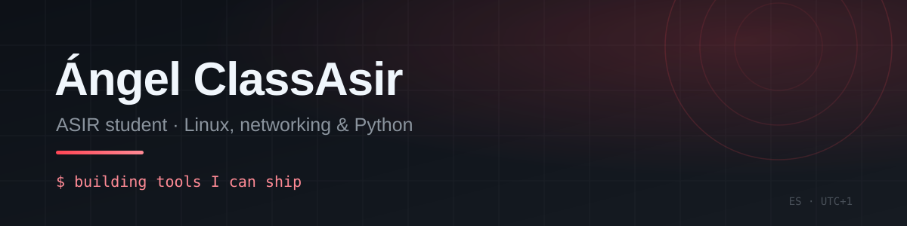

 

## Hi, I'm Ángel 👋

Systems administration student who builds tools, bots and small web apps for fun. I like projects I can ship, show and keep improving.

## About me

- **Studying** a vocational degree in **Network Systems Administration (ASIR)** in Spain
- **Building** with **Python** and the web: APIs, image generation, automation and static sites
- **Background** in systems and networking: GNS3, pfSense, VLANs, DMZ and Zabbix
- **2nd prize** at my first hackathon (enxarxaTEC 2026) with **NeuroVida**, an accessibility app
- **Long-term goal:** AI/ML engineering · **open to** internships, junior roles and freelance work

## Highlights

### 🏆 2nd prize — NeuroVida · enxarxaTEC 2026

An accessibility web app for neurodivergent workers: admins create tasks with simple steps and example images, workers track their pending tasks, and the app analyses whether they are gaining independence. Built with HTML, CSS, JavaScript and Supabase. I was the **lead developer** (app, task creation, website and database).

**[Certificate (PDF)](https://callmeangel.pages.dev/assets/certs/enxarxatec-2026-segundo-premio.pdf)** · **[News article](https://www.nayarsystems.com/blog/empresa/nayar-10-anos-impulsando-el-talento-joven-en-enxarxatec-camara-castellon-2026/)**

### 🖧 ASIR final project

A **pfSense** network with VLANs, a **DMZ**, **Zabbix** monitoring and **RAID 5** backups, built in **GNS3**.

## Featured project

### 🎴 StatCard

Turns any Valorant Riot ID into a polished, shareable PNG card: rank, K/D, win rate and recent matches. Python CLI + FastAPI backend + a dependency-free static frontend, live on Cloudflare Pages and Render.

**[Live demo](https://statcard.pages.dev)** · **[Source](https://github.com/angelclassasir/statcard)** · **[Changelog](https://github.com/angelclassasir/statcard/blob/master/CHANGELOG.md)**

## More projects

### 🎬 Dropline

A free panel for **Adobe After Effects** that downloads online videos (YouTube, Vimeo and 1000+ sites via `yt-dlp`) and imports them into the active composition at the playhead — in one click.

**[Source](https://github.com/angelclassasir/dropline)** · **[v1.0.0 release](https://github.com/angelclassasir/dropline/releases/latest)**

### 🎮 Roblox & Minecraft

- **+0.1 Studs** — an obby with **550 platforms** (the "HI-SCORE 550" on my site).
- **Brainrot Football** — a Roblox football card game with collectible characters, rarities and 2D matches.
- I also build **Minecraft servers, mods and projects**.

## Up next

- 🔐 **Cryptography playground** — client-side demos of Caesar, AES-256, SHA-256, RSA and an Enigma machine simulator. No backend, everything runs in the browser.

## Tech I use

**Languages**

**Backend & data**

**Engines & creative**

**Infrastructure & tooling**

**Networking & systems**

## Find me

---

  If StatCard is useful to you, a ⭐ on the repo helps a lot.

